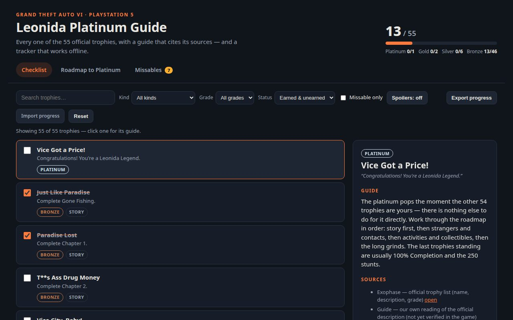

# Leonida Platinum Guide — GTA VI Trophy Guide &amp; Tracker

[](https://make.fun/bounty/gta6-trophy-guide-01)
[](https://make.fun/bounty/gta6-trophy-guide-01/leaderboard)
[](https://make.fun/bounty/gta6-trophy-guide-01)

An entry for the [make.fun](https://make.fun) bounty
[gta6-trophy-guide-01](https://make.fun/bounty/gta6-trophy-guide-01): an offline
web app that guides and tracks all 55 official PlayStation 5 trophies of Grand
Theft Auto VI. Everything runs in the browser from static files — no server, no
network, your progress never leaves your machine.



## What it does

- **Every trophy, official and complete** — all 55 names, descriptions and
  grades as PlayStation publishes them (1 platinum, 2 gold, 6 silver, 46
  bronze), each with a guide written for this entry in our own words.
- **Honest guides, cited sources** — each guide says where its facts come from
  (Exophase for the official list, PSNProfiles for PSN's progress targets).
  Where a step is not pinned down in any published source, the guide says so
  plainly instead of inventing a location or a step.
- **Tracker** — check trophies off; progress is saved in the browser
  (localStorage), with export to a JSON file and import back. A progress
  summary shows X/55, the percentage and per-grade counts.
- **Filters** — by kind (story, strangers &amp; contacts, collectibles,
  activities, crime, grinds, odd jobs), by grade, by earned/unearned, by
  missable only, and by text search.
- **Spoiler setting** — hides the names and descriptions of story trophies
  until they are earned.
- **Roadmap to the platinum** — four stages built from the official
  descriptions: story, strangers, activities and collectibles, then the
  grinds — each with its trophies and progress.
- **Missables flagged** — 7 trophies flagged from the official descriptions
  (1 clearly missable, 6 possibly), each with the reason it is flagged.

## How it works

`app/` is a plain static site: `index.html` plus ES modules under `app/src/`
(no build step, no libraries, no network requests). `app/data/trophies.json`
holds the 55 trophies with their guides, kinds, missable flags, roadmap stages
and PSN counts. `src/store.js` owns progress (localStorage, export, import),
`src/filters.js` owns filtering and the spoiler rule, `src/views.js` renders
the checklist, the guide pane, the roadmap and the missables, and `src/main.js`
boots the app and routes between views by URL hash.

`main.ts` (Node 22, standard library only) hands the entry in: it copies `app/`
and `screenshots/` to `/output` and writes `/output/dossier.json` with the
vendored make.fun library.

Try it locally:

```sh
node serve.ts
# open http://localhost:8080
```

## Sources and honesty

Trophy names, descriptions and grades are the official list as published by
Exophase and PSNProfiles (18 November 2026). PSN counts (42 Shooting Range
challenges, 14 drone race locations, 18 meditation spots, 52 areas, 9 gangs,
8 garages, 9 activity types, 500 choices) are PSNProfiles' progress targets.
The guides are our own words; nothing is copied from another guide, and no
Rockstar Games logo, artwork or text is used anywhere. An unofficial fan guide,
not affiliated with Rockstar Games or PlayStation.

## Licence

MIT — see [LICENSE](LICENSE).
